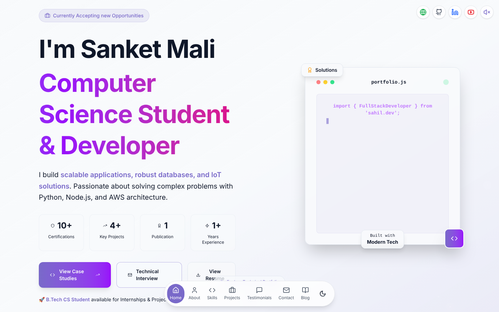
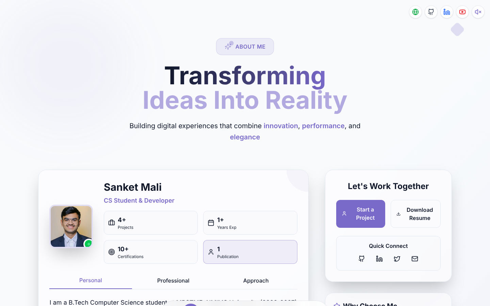
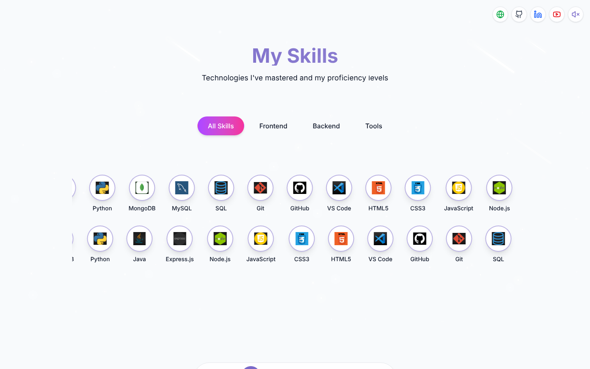
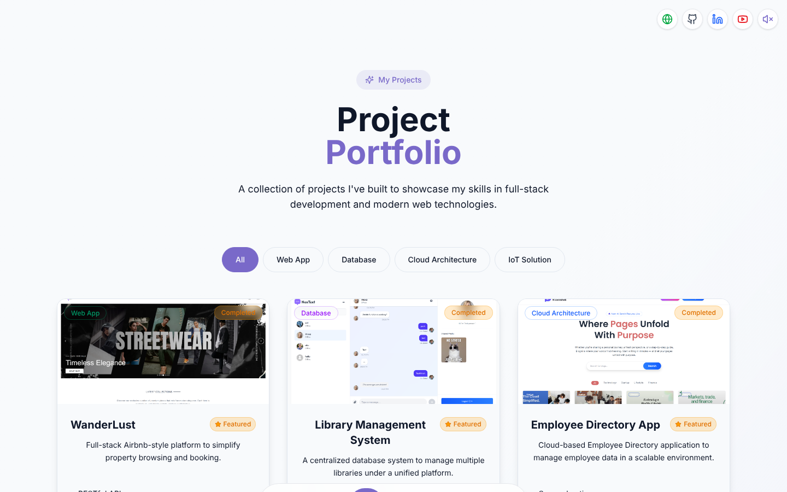
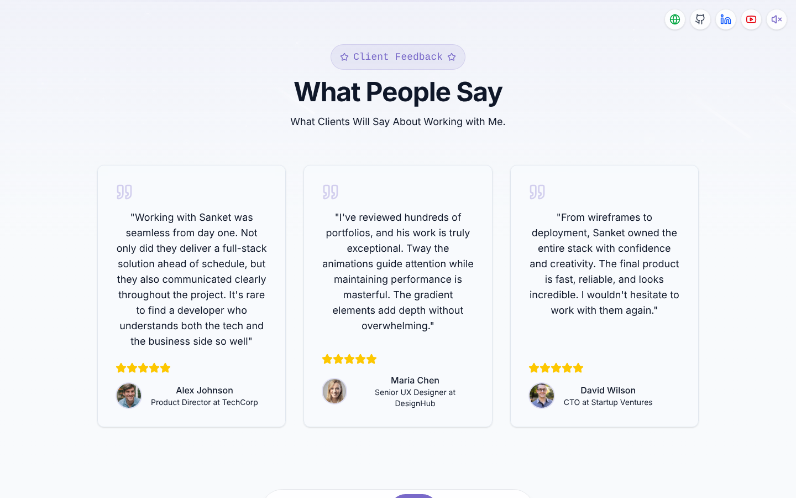
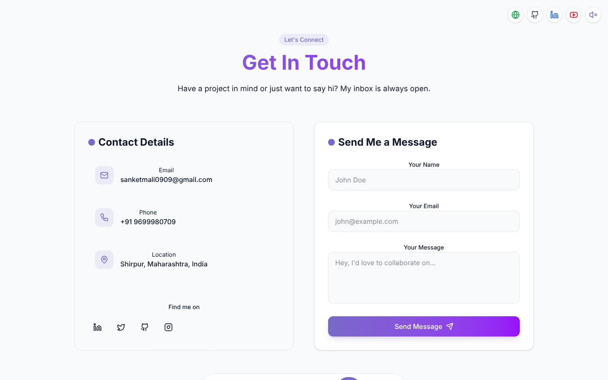
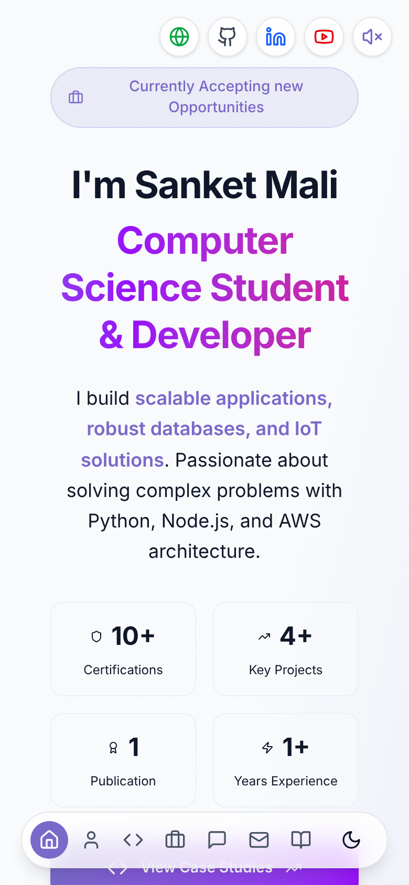

# Developer Portfolio: React + Vite + Tailwind

A responsive single-page developer portfolio with an animated starfield background, welcome screen and sections for About, Skills, Approach, Projects, Testimonials and Contact.

<p align="center">
  
</p>

## Screenshots

| About | Skills |
|:---:|:---:|
|  |  |
| **Projects** | **Testimonials** |
|  |  |
| **Contact** | **Mobile** |
|  |  |

## Features

- Animated welcome screen and starfield background
- Typing code-editor hero with quick stats and floating dock navigation
- Light/dark theme toggle and optional background music
- Filterable skills (Frontend / Backend / Tools) and projects (Web App, Database, Cloud, IoT)
- Working contact form via Formspree with toast notifications
- Fully responsive, animated with Framer Motion

## Tech stack

- React 18, React Router 7
- Vite 5
- Tailwind CSS 4
- Framer Motion
- Contact form posts to [Formspree](https://formspree.io)

## Project structure

```
client/
├── index.html
├── vite.config.js
└── src/
    ├── main.jsx, App.jsx
    ├── pages/            Home, NotFound
    ├── components/       Navbar, Hero, About, Skills, MyApproach,
    │                     Projects, Testimonial, Contact, Footer,
    │                     StarBackground, WelcomeScreen
    │   └── ui/           toast, toaster
    ├── hooks/            use-toast
    └── lib/              utils
```

## Getting started

Requires Node.js 18+.

```bash
git clone https://github.com/Sanket1516/React-Portfolio.git
cd React-Portfolio/client
npm install
npm run dev       # development server
npm run build     # production build in client/dist
```

## Customising

Content is written directly in the section components under `client/src/components/` (for example `ProjectsSection.jsx` and `SkillsSection.jsx`). The contact form endpoint is set in `ContactSection.jsx`; replace it with your own Formspree form ID.

## Author

Sanket Mali · [GitHub](https://github.com/Sanket1516)
